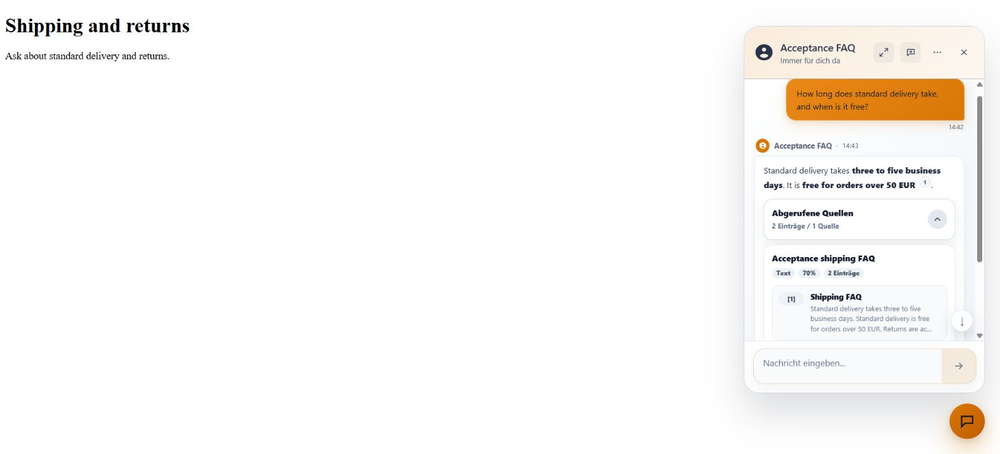
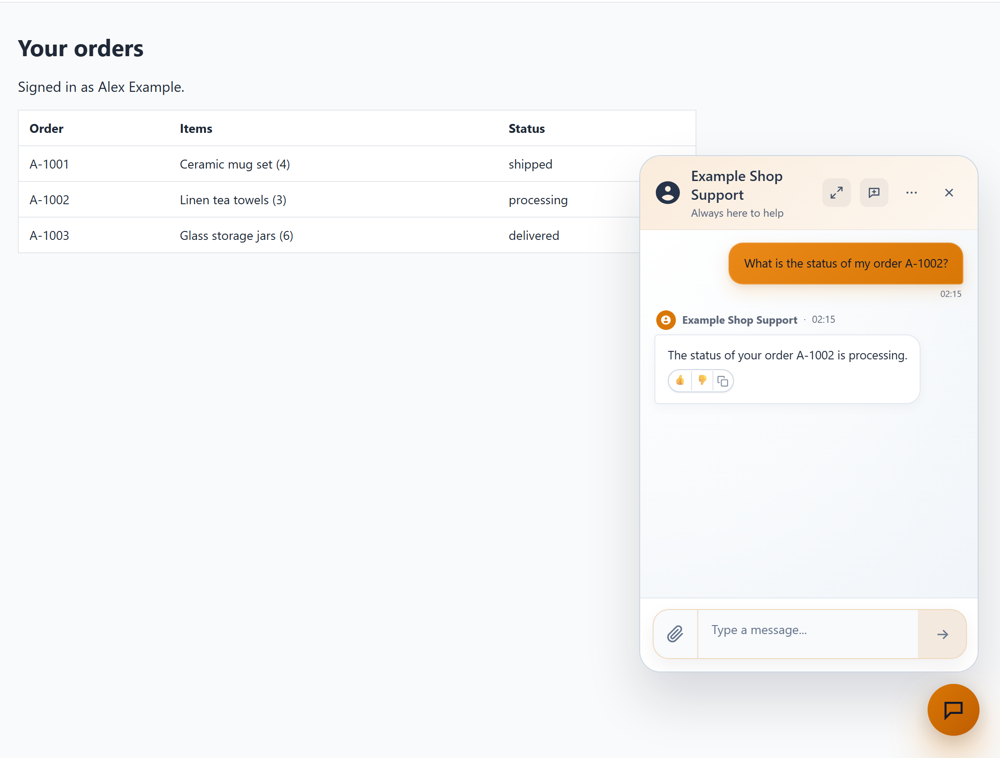
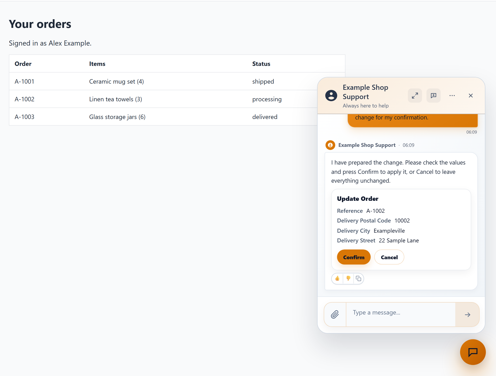
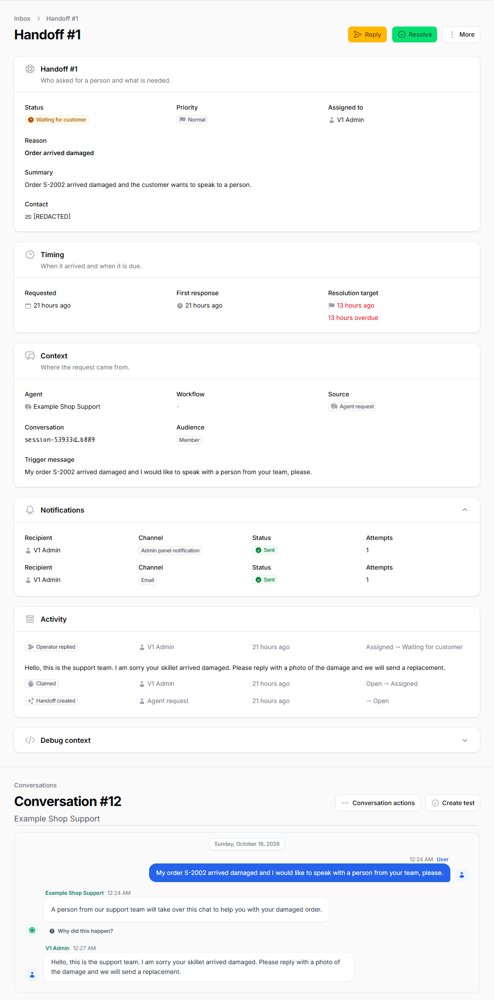
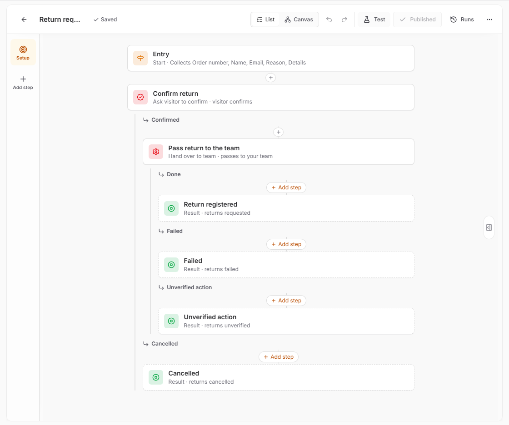

# Product Overview

Filament Agentic Chatbot helps customers answer support questions, check their orders and confirm permitted changes. Configure it in Laravel and Filament, host it yourself and use your own AI provider keys.

Selected release `v1.0.0`; intended publication `2026-10-19`. Approval is conditional release authorization, not completed acceptance. The source remains a release candidate until required local gates and publisher finalization pass. Published status and exact source/archive identity come from the canonical [GitHub v1.0.0 Release](https://github.com/heinergiehl/filament-agentic-chatbot/releases/tag/v1.0.0). Approval metadata alone does not establish publication. Start with the [Quick Start golden path](QUICKSTART.md#7-golden-path-agent-to-live-deployment). Match these instructions to your download using [Compatibility](COMPATIBILITY.md).

## A shop conversation

1. A visitor asks about delivery. The Agent searches the shop's approved Sources and can cite the content used.
2. The visitor signs in through the shop's existing login and asks for Order status. An App data tool reads only the customer's scoped orders.
3. The customer asks to change a delivery address, checks the proposed values and presses **Confirm**. The host's field rules, ownership and model policy govern the update.
4. An unresolved issue goes through **Handoff** to the Inbox, where an operator can reply.

This is a configuration recipe, not an included commerce integration or a recorded end-to-end shop demonstration. You provide the order model, identity, scopes, policies and production validation.

Answer a public delivery question from your approved Sources.

Actual anonymous FAQ answer and Source citation, captured on 2026-10-19 with
`claude-haiku-5-5` at effort `low` and `gemini-embedding-001` at 1,536 dimensions.
This is local C1 evidence, not final source/archive certification. The other
images retain their dated capture scope; see the
[screenshot provenance](https://github.com/heinergiehl/agentic-chatbot-filament-docs/blob/main/RELEASE_NOTES_v1.0.0.md#evidence-and-release-readiness).

Read Order status after the customer's normal host login.

Review a permitted delivery address change before confirming.

Continue an unresolved conversation in the team's Inbox.

Add a Workflow when support needs a defined sequence.

## What to configure

| Area | What it provides | Boundary |
| --- | --- | --- |
| Agent | Instructions, provider/model, Sources and Tools; Test, Publish and Restore | Test uses the saved Draft with simulated writes. A published Version pins configuration; availability is Live or Paused. |
| Sources | Text, Files, Websites and JSON API content; retrieval with citations | Retrieval supports grounding, not guaranteed answer correctness. Database vector search has capacity limits. |
| App data tools | Approved Eloquent reads, inserts and updates; Filament Resource import proposals | Review fields and row scopes. Import grants no panel privileges; production queries require a server database. |
| API tools and MCP tools | Selected operations from configured Connections | Check protocol/authentication and staging requirements in the relevant guides. |
| Workflow | Optional bounded multi-step process in a step list or canvas | Ordinary conversation needs no Workflow; one active Workflow per conversation. |
| Inbox | Handoff, team approvals and Unverified actions | Configure authorized recipients and operate reconciliation deliberately. |
| Conversations | Conversations, submissions, feedback, usage and operational analytics | Absence of Handoff is not proof of resolution or time saved. |

Confirmation is on by default. Personal App data tool writes, MCP writes, lead capture and updates with **Allow updating any record** require it. Eligible operations can have **Ask visitor to confirm** disabled by an administrator. Team approval is separate, and all operations remain subject to authorization and execution checks. An Unverified action needs reconciliation rather than an unproven replay.

## Setup and responsibility

Install through your private Composer repository, register the plugin, grant access explicitly, configure your provider key, then run the installer and background services. The [Quickstart](QUICKSTART.md) separates anonymous FAQ setup from customer identity, scopes and policy evaluation in queue workers.

You operate the host app, users, tenancy, database, provider account, queues, scheduler, shared cache and backups. Review [Known limitations](KNOWN_LIMITATIONS.md) and [Security and privacy](SECURITY_AND_PRIVACY.md) before production access.

Start with the public FAQ path. Add customer Tools only after the host supplies
trusted identity, explicit record scopes and the required policies to the queue
worker. Recheck those boundaries with a second customer and tenant, then verify
Confirm, Cancel and stale-data behavior in staging. The Inbox is an operational
responsibility: notification delivery and Unverified actions need monitoring.
Publication of an Agent Version does not verify this host integration for you.

- [Demo](https://filament-agentic-chatbot.heinerdevelops.tech/) and [Buy](https://checkout.anystack.sh/agentic-chatbot)
- [Sources](KNOWLEDGE_SOURCES.md), [App data tools](DATA_RESOURCES.md), [API tools](API_CONNECTORS.md) and [MCP tools](MCP_CONNECTIONS.md)
- [Workflow Builder](PLAYBOOK_BUILDER.md), [Widget](CHAT_WIDGET.md), [Agents](BOTS.md) and [Glossary](GLOSSARY.md)
- [Support](SUPPORT_POLICY.md) and [License/refunds](REFUND_AND_LICENSE.md)
