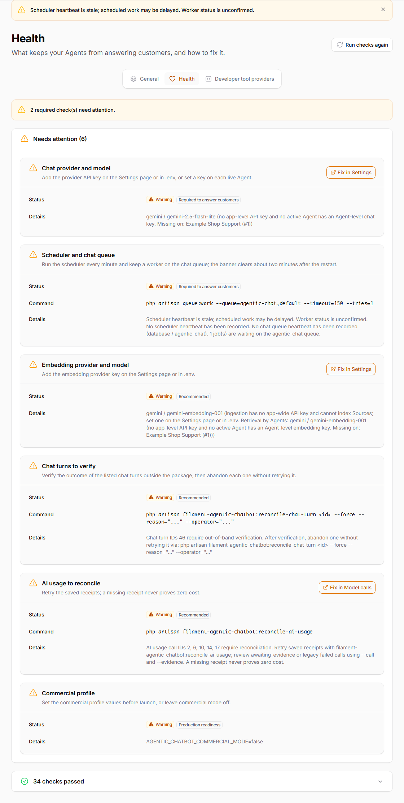
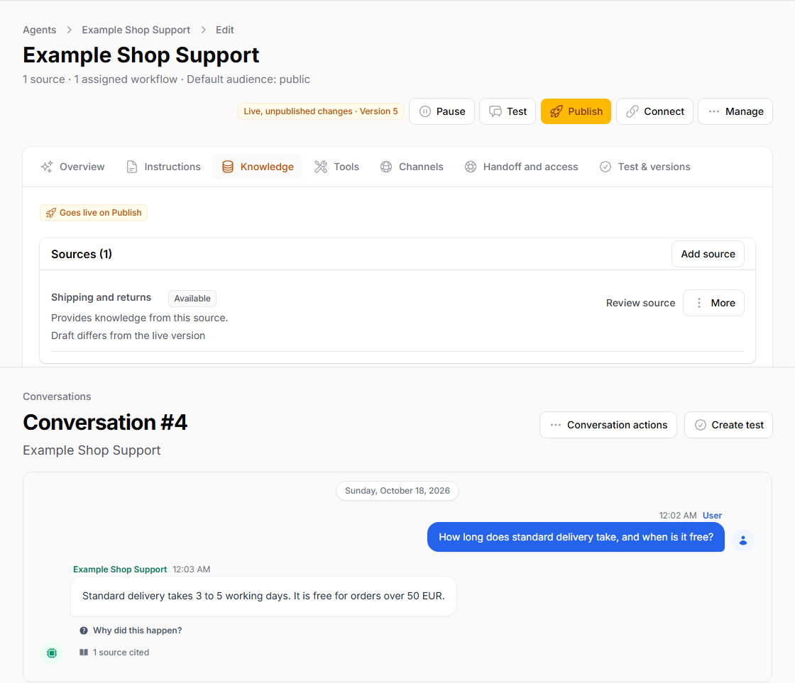
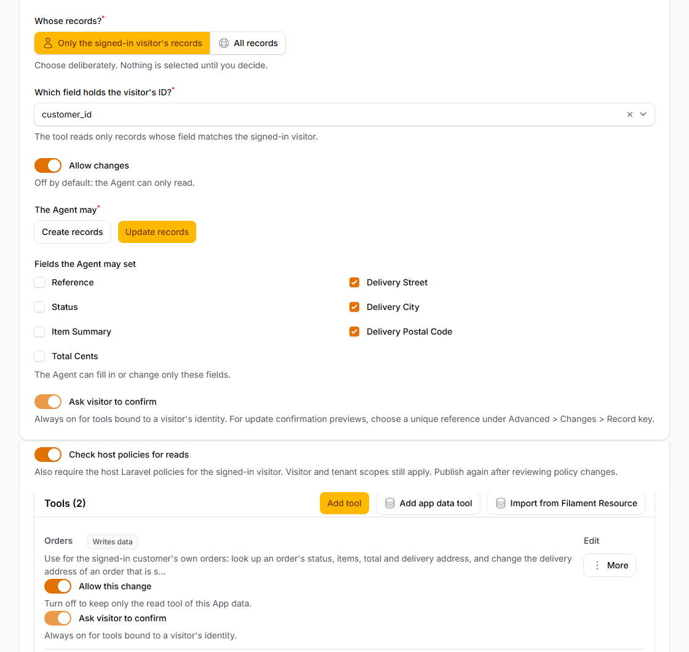

# Quick Start

Create an anonymous FAQ Agent first, then add authenticated customer data in a separate recipe. Published `v1.0.0` on `2026-10-19` at `17:40:33 UTC`. The verified [GitHub v1.0.0 Release](https://github.com/heinergiehl/filament-agentic-chatbot/releases/tag/v1.0.0) is the publication authority; approval metadata alone does not establish publication. See the [published source and archive identity](https://github.com/heinergiehl/agentic-chatbot-filament-docs/blob/main/RELEASE_NOTES_v1.0.0.md#published-artifact). Check [Compatibility](COMPATIBILITY.md) against your download. Existing installations must follow [Upgrading to 1.0](https://github.com/heinergiehl/agentic-chatbot-filament-docs/blob/main/UPGRADING.md#upgrading-to-10) before migrations.

Prepare the framework, database, provider account, worker, scheduler and shared
cache before starting the FAQ recipe. Provisioning is separate from Agent setup.
No measured setup-time result is claimed for this release; record your own
elapsed time and blockers rather than treating the recipe as a timing guarantee.

## Try the live shop demo

The [Example Shop](https://filament-agentic-chatbot.heinerdevelops.tech/shop)
runs the published v1.0.0 package. It is a fictional shop with isolated sample
orders, not an included commerce integration for your installation.

1. Open the shop, select **Sign in**, choose **Alex** and continue without a password. Each browser session receives separate fictional customers and orders. The live shop requires sign-in before opening chat.
2. Open the shop chat and ask “How do delivery and returns work?” Compare the answer and its Source citation with the [shop policy](https://filament-agentic-chatbot.heinerdevelops.tech/shop/policy). Then ask “Show my order status.” The account page also lists your sample orders.
3. Ask to change the delivery address on processing order **A-1002**, using fictional street, city and postal code values. The address-change Playbook reads the current order and presents native **Confirm** and **Cancel** controls. Review the order and proposed values before Confirm. Then reload **Account** to inspect the address and version; Cancel leaves the address unchanged. Shipped orders cannot use this address change.
4. Ask for a person about a fictional damaged parcel. Handoff creates a private staff Inbox request and internal database notification. A staff reply requires an authorized operator; no email or response time is promised. The completed acceptance verified a stored reply in authorized owner history, but did not capture it in the live widget or establish automatic foreground polling.
5. Use **Switch fictional identity** and select **Sam**. Sam has separate orders and cannot read or change Alex's orders. A fresh browser session uses separate data again.

Use fictional details only; chat messages can reach the configured providers.
The accepted demo used `claude-haiku-5-5` at effort `low` and
`gemini-embedding-001` at 1,536 dimensions. Native evidence confirmed a cited
FAQ, own-order reads, one confirmed address write and a completed Graph run.
The model's follow-up was unnecessarily doubtful despite that successful
write; use the account record and execution evidence to verify outcomes.
This bounded acceptance does not establish every dialogue, SMTP delivery,
automatic reply polling or long-duration stability. See the
[release evidence and limits](RELEASE_NOTES_v1.0.0.md#verified-live-shop-demo)
and the demo's [privacy notice](https://filament-agentic-chatbot.heinerdevelops.tech/shop/privacy).

## 1. Prepare your Laravel and Filament app

You need Composer 2.2+, PHP 8.3+ with the extensions required by Composer (including ZIP), Laravel 12.61.1+ or 13.12.0+, and Filament 5.10.2+ within 5.x. Install Filament in the host app before registering this plugin. Package storage uses the application's default database: MySQL 8.4+, MariaDB 11.4+, PostgreSQL 15+ or SQLite 3.39+.

Use your own AI provider account and keys. Provider charges and infrastructure are separate from the plugin license. Model/tool support depends on the selected provider and model; no live provider acceptance is implied by this guide.

For a brand-new app, create Laravel and install Filament first:

```bash
composer create-project laravel/laravel my-app "^13.0"
cd my-app
composer require filament/filament "^5.10.2"
php artisan filament:install --panels --no-interaction
```

If `app/Providers/Filament/AdminPanelProvider.php` was not created, run `php artisan make:filament-panel admin`. Existing Filament apps can proceed directly to step 2.

## 2. Install a fresh application

After purchase, copy your private Composer repository URL and credentials from Anystack. Replace the placeholder below. Never commit credentials or Composer `auth.json`.

```bash
composer config repositories.filament-agentic-chatbot composer https://YOUR-ANYSTACK-PRODUCT.composer.sh
composer require heiner/filament-agentic-chatbot:^1.0
```

The `^1.0` command selects the published 1.0 line through your purchased channel. Authenticate with the buyer email and license key shown by Anystack. If activation is enabled, use its displayed `<license-key>:<fingerprint>` password. See [Troubleshooting](TROUBLESHOOTING.md) for authentication and first-run errors. Follow [Anystack's Composer instructions](https://anystack.sh/docs/integrations/php) for authentication.

Register the plugin in your existing panel provider's `plugins()` list, retaining other plugins:

```php
use Filament\Panel;
use Heiner\FilamentAgenticChatbot\FilamentAgenticChatbotPlugin;

public function panel(Panel $panel): Panel
{
    return $panel->plugins([
        FilamentAgenticChatbotPlugin::make(),
        // Keep your other plugins here.
    ]);
}
```

### Grant access

Panel login alone grants no plugin administration. Grant access deliberately in the panel provider. For a host with an `is_owner` boolean on its `App\Models\User`, this grants all plugin abilities only to owners:

```php
use App\Models\User;
use Heiner\FilamentAgenticChatbot\FilamentAgenticChatbotPlugin;

FilamentAgenticChatbotPlugin::make()
    ->authorizeUsing(fn (User $user, string $ability): bool => $user->is_owner === true),
```

Adapt that host-specific condition to your permission system. The four abilities are `filament-agentic-chatbot.operate`, `.configure`, `.publish` and `.admin`. Admin includes the other three. Record-scoped grants also need scoped lists; see [administration abilities](SECURITY_AND_PRIVACY.md#administration-abilities). Upgraded installations retain their existing strict Gates until deliberately switched.

## 3. Configure keys and background services

Before running the installer, choose a persistent Laravel database or Redis queue and a cache shared by web, scheduler and worker processes. Do not use the `sync` queue or `array` cache for streaming widget chat. For Redis, provision the queue infrastructure; the installer does not run it for you.

```bash
php artisan filament-agentic-chatbot:install
```

The installer asks for your AI provider/key, queue connection and, if needed, permission to register the panel plugin. It stores the provider key encrypted, publishes configuration, runs migrations, creates missing queue tables, initializes the signing key and runs Doctor. It does not grant administrator access. In a production environment, review pending migrations before using the installer's `--force-migrations` option to authorize them. A non-interactive run edits no host PHP and stores no provider key; use Settings afterward.

Start and supervise the worker. With the default chat and ingestion queues:

```bash
php artisan queue:work --queue=agentic-chat,default --timeout=150 --tries=1
```

Set the queue connection's `retry_after` above the worker timeout; 360 seconds covers the defaults. With Laravel's default database queue configuration, set `DB_QUEUE_RETRY_AFTER=360` in `.env` before starting the worker. `api.chat_queue.queue` defaults to `agentic-chat`; ingestion uses the host default unless `ingestion.queue` is set. If your host default queue or these settings differ, serve those queue names too.

Run the scheduler every minute, with your application's absolute path:

```cron
* * * * * cd /path/to/app && php artisan schedule:run >> /dev/null 2>&1
```

The scheduler and worker record heartbeats used by Setup. Source re-sync and other maintenance need the scheduler. Web, scheduler and workers must use the same shared cache. Each open streaming chat occupies a PHP worker; size your web workers for concurrent chats. On a single-process development server, set `AGENTIC_CHATBOT_CHAT_STREAM_RELAY_SECONDS=0` to use polling.

An administrator configures provider keys and the default chat/embedding profile on **Settings**. Fresh installs need no custom database or vector service settings. Keep the default database vector backend within its per-Agent limits: warning at 800 text sections and refusal at 3,000 with 1,536 dimensions (limits scale down at larger dimensions). For larger collections see [Ingestion and retrieval](INGESTION_AND_RETRIEVAL.md).

### Provider environment keys

The installer and **Settings** store keys encrypted. For deployments managed through `.env`, these are the provider keys read by the runtime catalog and Laravel AI's `config/ai.php`. Agent-specific credentials take precedence over Settings, then environment configuration. Choose a model that supports the required chat or embedding functions; this table does not certify a live provider account.

| Provider | Environment key / endpoint | Use |
| --- | --- | --- |
| Google Gemini | `GEMINI_API_KEY` | Chat and embeddings |
| OpenAI | `OPENAI_API_KEY` | Chat and embeddings |
| Anthropic | `ANTHROPIC_API_KEY` | Chat |
| xAI | `XAI_API_KEY` | Chat |
| OpenRouter | `OPENROUTER_API_KEY` | Chat and embeddings |
| DeepSeek | `DEEPSEEK_API_KEY` | Chat |
| Groq | `GROQ_API_KEY` | Chat |
| Mistral | `MISTRAL_API_KEY` | Chat and embeddings |
| Azure OpenAI | `AZURE_OPENAI_API_KEY`, `AZURE_OPENAI_URL`, `AZURE_OPENAI_DEPLOYMENT`, `AZURE_OPENAI_EMBEDDING_DEPLOYMENT` | Chat and embeddings; configure the endpoint and deployments |
| Ollama | `OLLAMA_URL`, optional `OLLAMA_API_KEY` | Chat and embeddings; default URL `http://localhost:11434` |
| Cohere | `COHERE_API_KEY` | Embeddings |
| Jina AI | `JINA_API_KEY` | Embeddings |
| Voyage AI | `VOYAGEAI_API_KEY` | Embeddings |
| OpenAI-compatible | `AGENTIC_CHATBOT_OPENAI_COMPATIBLE_API_KEY`, `AGENTIC_CHATBOT_OPENAI_COMPATIBLE_BASE_URL`, `AGENTIC_CHATBOT_OPENAI_COMPATIBLE_DRIVER` | Custom chat endpoint; see [OpenAI-compatible providers](OPENAI_COMPATIBLE_PROVIDERS.md) |

Provider names, defaults and the custom endpoint options are configured in `config/filament-agentic-chatbot.php`; standard provider credentials and URLs are configured by Laravel AI. Keep keys out of browser code and source control. After changing cached environment configuration, rebuild the host's config cache and restart its supervised workers.



Check required setup before serving visitors.

## 4. Short path: anonymous FAQ

1. Open **Agentic Chatbot > Build > Agents**, choose the **Customer support with handoff** template, set **Purpose** to **Answer from my content** and select your configured provider/model.
2. Add a text Source containing a short shipping FAQ. Wait for ingestion to complete. Attach only that Source, then press **Save draft**; leave customer data Tools unassigned.
3. **Test** a delivery question and inspect the answer and citation. Test unfamiliar wording and an unanswered question too.
4. Configure Handoff recipients who may operate this Agent's Inbox. Check business hours and the outside-hours message if you offer escalation.
5. **Publish**. The first Publish can make the Agent Live; keep it Paused if the website is not ready. Later publications and **Restore** preserve Live/Paused availability.
6. Follow the production website checks below, then copy the generated embed and verify one anonymous conversation.

No Workflow or host identity endpoint is needed for this public FAQ path. Answer quality depends on your content and model. Test uses the saved Draft and simulates writes; it is not proof of a production write. **Appearance preview** shows sample messages only.

If ingestion or retrieval fails, inspect the Source status, Health and Doctor
before publishing. A plausible answer without the expected Source citation does
not establish that retrieval worked. Keep customer Tools unassigned while
resolving the FAQ path; weakening identity or row scopes cannot fix retrieval.



The answer is retained historical Test evidence, not a new Test of the current
Draft. Test your saved FAQ Draft before publishing.

## 5. Publish the website safely

Before production access, use the **Allowed hosts** field in the **Allowed websites** section of **Channels** to allow the intended website, configure a dedicated signing key and set `AGENTIC_CHATBOT_WIDGET_SIGNING_TTL_MINUTES=10` for the widget access token lifetime. Set `AGENTIC_CHATBOT_WIDGET_CONTEXT_TTL_MINUTES=10` separately for the signed customer context lifetime. The installer can initialize the key; never expose it in browser code. An empty **Allowed hosts** list blocks public widget access.

When the Agent allows several languages and has no custom visitor texts, the widget follows the browser language among those languages. Otherwise it keeps the configured widget language.

Copy the generated URL and Agent ID. The generated snippet contains no token:

```html
<script
    src="https://your-app.example/filament-agentic-chatbot/widget"
    data-bot="YOUR_BOT_PUBLIC_ID"
    data-area="public"
    data-size-preset="comfortable"
    data-font-preset="modern-sans"
    data-show-sources="true"
    defer
></script>
```

Production uses tokenless bootstrap at `POST /api/filament-agentic-chatbot/chat/{botPublicId}/bootstrap` and short-lived tokens. Configure HTTPS, CSP and the shared cache as described in [Chat Widget](CHAT_WIDGET.md).

## 6. Separate recipe: signed-in order support

Use a supported **server database** for production App data tools. SQLite App data tool queries run only in `local` and `testing`. This is a host integration recipe: `App\Models\Customer`, its `is_active` field, `stores()` relation and the order model/policy are examples you implement, not package classes.

### Host identity endpoint

Keep your normal customer login. A same-origin widget can use the host session when `api.include_session_auth_context` is enabled. An external embed needs an endpoint in the trusted Laravel host that issues signed context from its authenticated session.

Example for `routes/web.php`: replace the Agent ID and origin. This example grants only the `member` audience, requires an active customer and fixes identity to the host's Customer model. For a multi-tenant shop, also authorize the selected store server-side and pass its trusted tenant type/ID to the issuer. Do not accept identity or tenant from query parameters.

```php
use App\Models\Customer;
use Heiner\FilamentAgenticChatbot\Models\Bot;
use Heiner\FilamentAgenticChatbot\Support\WidgetContextToken;
use Illuminate\Http\Request;
use Illuminate\Support\Facades\Route;

Route::get('/chat/customer-context', function (Request $request) {
    $headers = ['Cache-Control' => 'no-store, private', 'Pragma' => 'no-cache'];
    $customer = $request->user(); // use your customer guard if it is not the default

    if ($customer === null) {
        return response()->noContent(204, $headers);
    }

    abort_unless($customer instanceof Customer && $customer->is_active, 403);
    abort_unless($request->string('bot')->toString() === 'YOUR_AGENT_PUBLIC_ID', 403);
    abort_unless($request->string('area')->toString() === 'member', 403);
    $bot = Bot::query()->where('public_id', 'YOUR_AGENT_PUBLIC_ID')->firstOrFail();

    $issuance = WidgetContextToken::issueForBot(
        bot: $bot,
        origin: 'https://shop.example.com',
        area: 'member',
        actor: ['type' => 'customer', 'id' => (string) $customer->getKey()],
    ) ?? abort(503);

    return response()->json($issuance->toArray())->withHeaders($headers);
});
```

Configure `AGENTIC_CHATBOT_CONTEXT_ALLOWED_AREAS=public,member`, `AGENTIC_CHATBOT_WIDGET_CONTEXT_REQUIRED_AREAS=member` and `AGENTIC_CHATBOT_WIDGET_CONTEXT_AUTHORIZES_NON_PUBLIC_AREAS=true`. Set `AGENTIC_CHATBOT_WIDGET_SIGN_IN_ROUTE` to your host login route. Use `data-area="member"` and `data-context-endpoint="https://app.example.com/chat/customer-context"` on the embed. Cross-origin deployments need exact credentialed CORS and usable session cookies; browsers may block third-party cookies. Tokens are signed, not encrypted. Never include secrets. See [signed customer context](CHAT_WIDGET.md#signed-customer-and-tenant-context).

The customer context lifetime is controlled by `AGENTIC_CHATBOT_WIDGET_CONTEXT_TTL_MINUTES`; `AGENTIC_CHATBOT_WIDGET_SIGNING_TTL_MINUTES` controls the separate widget access token.

On login, logout or tenant switch, reload the page or call `await widget.refreshContext()` on your mounted SDK instance. A signed identity is not permanent authority.

### Record scopes and queue policy

1. Configure the host actor resolver before creating a personal App data tool. Merge this into `config/filament-agentic-chatbot.php`, keeping the other context settings:

```php
'host_actors' => [
    'types' => ['customer' => App\Models\Customer::class],
    'ability' => 'filament-agentic-chatbot.serve-customer',
],
```

The full configuration path is `filament-agentic-chatbot.context.host_actors.types`.

Keep the type map in the published configuration file, inside `context`; it is
supported by configuration cutover. Each mapped class must exist, extend
Eloquent `Model`, implement `Authenticatable` and be concrete. Package models
and their subclasses are forbidden. Aliases must match
`[a-z][a-z0-9_-]{0,63}` exactly: 1 to 64 characters, starting with a lowercase
letter, without whitespace or control characters. Each class may appear only
once, including alternate class-name casing or a leading backslash. A list of
distinct model classes is also supported for class-name identity types from
same-origin guards (ADR 0057); do not mix list entries and aliases.
Use a shared host `User` model only when it is intentionally your customer
identity model and the host ability restricts it accordingly. Panel membership
never supplies an implicit actor mapping.
Setup reports an invalid map, class or missing resolver ability as **Blocked**.
The entire invalid map is refused before any host actor or Gate is resolved;
it never opts into scope-only execution or silently overwrites an alias.

Signed context works together with session authentication, including a host
`customer` session guard and `AGENTIC_CHATBOT_API_INCLUDE_SESSION_AUTH_CONTEXT=true`.
The session model must match the class mapped to the signed alias, and its
authentication identifier must match the signed ID. A different customer or an
unmapped session model receives `403 widget_context_invalid`. When no session
user accompanies the request, the signed identity still authorizes the
configured member area. The signed alias stays in queued authority and scopes.

Exactly one valid mapping must name the session model; zero or multiple mappings
return `403 widget_context_invalid`, even for tokens issued from a user model
whose signed type is its class name. A tenant-only token does not exempt an
accompanying session from this check. There is no raw class-name fallback. In
`AppServiceProvider::boot()`, define the named ability. This example rejects
inactive accounts and checks any attested store membership:

```php
use App\Models\Customer;
use Heiner\FilamentAgenticChatbot\Support\HostActors\HostActorReference;
use Illuminate\Support\Facades\Gate;

Gate::define('filament-agentic-chatbot.serve-customer',
    fn (Customer $customer, HostActorReference $reference): bool =>
        (bool) $customer->is_active
        && ($reference->tenantId() === null
            || $customer->stores()->whereKey($reference->tenantId())->exists())
);
```

The resolver reloads the customer and rechecks that ability in the worker. Registered model policies run as that customer, not the worker's auth guard or an administrator. Register your Order model policy in the host app; for read-policy enforcement enable **Advanced > Check host policies for reads**, as described in [App data tools](DATA_RESOURCES.md#optional-host-policy-checks-for-reads). Custom tenancy context belongs in a host implementation of `Heiner\FilamentAgenticChatbot\Contracts\HostActorResolver`, including its `within()` scope.

2. In the Agent's Tools, add an App data tool for your host Order model, or import a Filament Resource proposal. Review it, then press **Save draft** on the Agent after saving the Tool.
3. Expose only the fields needed for Order status. Bind ownership to **both** `actor.id` and `actor.type`; bind tenant-owned records to `tenant.id` as well. When exactly one host actor type is configured, the Tool pins that type automatically. With several types, choose the intended type explicitly. Identity comes from trusted host context, never the customer's message.
4. Start with a read-only Tool. Verify the customer's own order, another customer's order, a guest, a disabled account, logout, tenant switch and delayed queue execution.
5. For delivery address changes, allow only the address fields, exact record identity and an optimistic version field. Use the order reference column as **Advanced > Changes > Record key** when it uniquely identifies the scoped order, so the confirmation card names that reference. Configure the host update policy and staging evidence described in [App data tools](DATA_RESOURCES.md#isolated-staging-evidence-before-publication). Publish the reviewed Tool assignments with the Agent.
6. Keep confirmation on. Personal App data tool writes require it. Verify Confirm, Cancel, stale record versions and duplicate submissions; reconcile an Unverified action before another write.
7. Verify Handoff notifications and an operator reply in the same conversation.

Confirmation is on by default. Administrators may disable **Ask visitor to confirm** for eligible operations; personal App data tool writes, MCP writes, lead capture and updates with **Allow updating any record** always require confirmation. Team approval remains separate. Disabling confirmation does not bypass authorization.

Do not enable personal Tools until identity, scopes, model policy and worker execution are verified in your staging host. Context expiry or revocation can stop personal work after a wait; see [Known limitations](KNOWN_LIMITATIONS.md#18-customer-identity-limits-adr-0057).



Review customer scopes and policy before enabling personal Tools.

## 7. Golden Path: Agent To Live Deployment

### 1. Create the Agent

Create an Agent in **Agentic Chatbot > Build > Agents**. Configure the provider/model and the job it should do.

### 2. Connect only what the Agent needs

Attach [Knowledge Sources](KNOWLEDGE_SOURCES.md). Add reviewed [App data tools](DATA_RESOURCES.md) or an [API connection](API_CONNECTORS.md) only when needed. The authenticated recipe above is a prerequisite for personal data.

### 3. Add an optional Workflow

Add a Workflow only for a bounded multi-step process. A canvas is not required. Ordinary FAQ chat works without one.

### 4. Test and publish

**Test** the saved Draft, then **Publish**. The Agent answers through one hash-verified live deployment. **Restore** selects an earlier Version; later publication and restore preserve Live/Paused availability.

### 5. Verify the live Agent

Check an answer, an unanswered question and Handoff on the actual website. Check scoped reads and confirmed changes only if you configured those Tools. Review conversation and execution evidence in Filament.

## 8. Advanced: Workflow Building

Use a step list or canvas when input collection, branching, team approval or a defined sequence is needed. Test and publish the Workflow, assign it to the Agent Draft, then publish the Agent. Follow [Workflow Builder](PLAYBOOK_BUILDER.md) for supported Steps and limits.

## Final setup check

Run `php artisan filament-agentic-chatbot:doctor` after configuring keys, workers, scheduler and website access. Resolve required failures on Setup, verify queue heartbeats, then run your staging conversations. Setup time depends on the prepared host and configuration; no fixed setup time is promised.

[Operations](OPERATIONS.md) covers supervision and recovery. [Support](SUPPORT_POLICY.md) and [license/refunds](REFUND_AND_LICENSE.md) explain purchase coverage.
